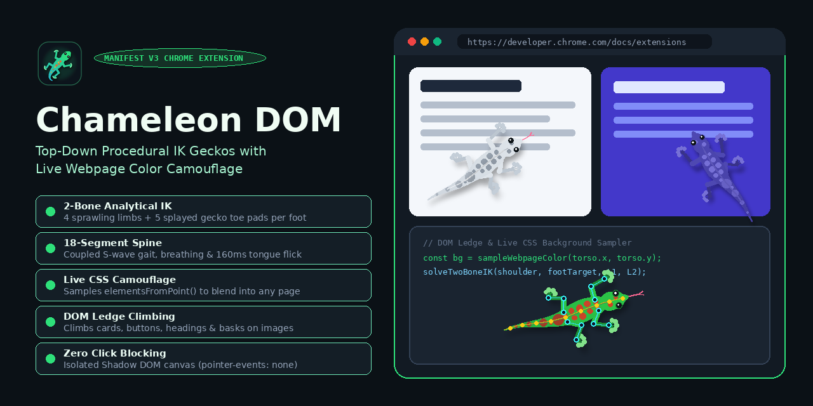
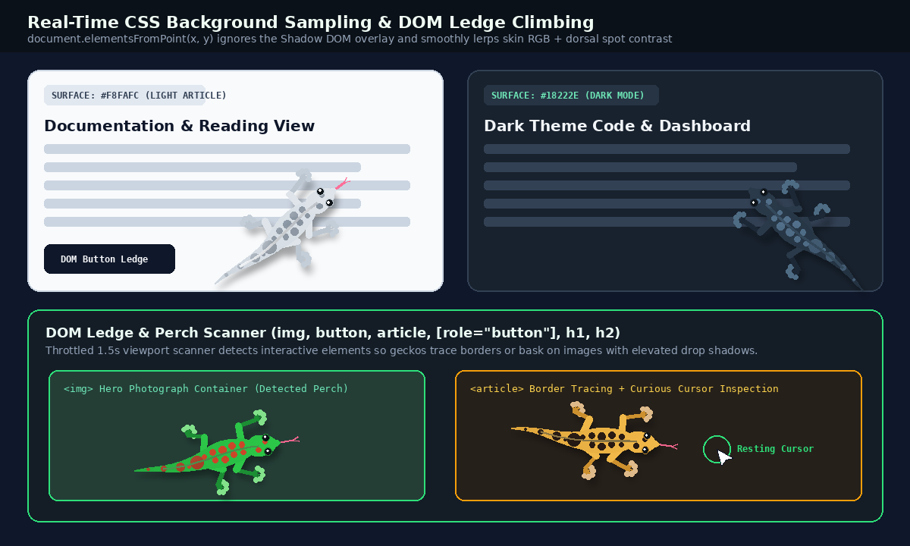
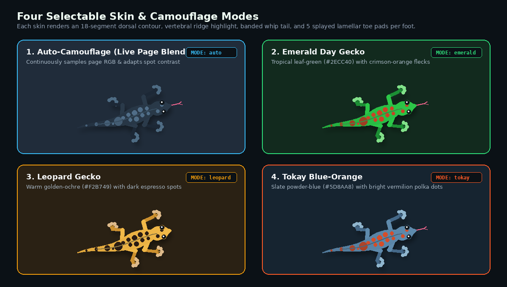
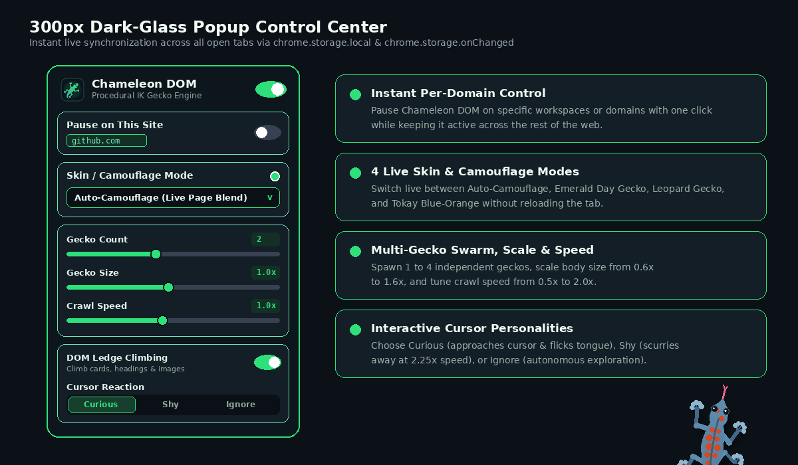

<div align="center">

  

  <h1>🦎 Chameleon DOM</h1>
  <p><strong>Realistic Top-Down Procedural IK Geckos with Live Webpage Color Camouflage &amp; DOM Ledge Climbing</strong></p>

  <p>
    <a href="#-quick-download--installation-1-minute"></a>
    
    
    
  </p>

  <br />

  

</div>

<br />

## ✨ Overview

**Chameleon DOM** is a lightweight, high-craft **Manifest V3 Chrome Extension** that brings active webpages to life with realistic, bird's-eye-view geckos. Powered by a custom **4-legged 2-bone analytical Inverse Kinematics (IK) solver**, an **18-segment articulated spine**, and **real-time CSS surface color sampling**, each gecko crawls across your screen, climbs over DOM cards and images, and blends seamlessly into light themes, dark mode, and colored banners—**without ever blocking a single click, scroll, or text selection**.

---

## 📥 Quick Download &amp; Installation (1 Minute)

Want to try **Chameleon DOM** right now? No build tools or `npm install` required—load it directly into **Chrome**, **Brave**, **Edge**, or **Opera**:

<div align="center">
  <a href="../../releases/latest">
    
  </a>
</div>

1. **Download the Extension:**
   - Click the [**Releases**](../../releases) tab on this GitHub page and download **`chameleon-dom-v1.0.0.zip`** (or click **`Code` → `Download ZIP`** at the top of this repository).
2. **Extract the Folder:**
   - Unzip the downloaded archive on your computer so you have the folder containing `manifest.json`.
3. **Open Browser Extensions:**
   - In Chrome, navigate to `chrome://extensions` (or `brave://extensions` in Brave / `edge://extensions` in Edge).
4. **Enable Developer Mode:**
   - Flip the **Developer mode** toggle switch in the **top-right corner** to **ON**.
5. **Load Unpacked:**
   - Click the **Load unpacked** button in the top-left corner and select the extracted **`chameleon-dom`** folder.
6. **Enjoy!**
   - Open any website and watch your geckos crawl, climb DOM ledges, and camouflage in real time. Pin the **Chameleon DOM** icon in your toolbar to customize skins, count, speed, and cursor reactions anytime.

---

## 📸 Screenshots &amp; Visual Tour

### 1. Real-Time Webpage Color Camouflage &amp; DOM Ledge Climbing
Using `document.elementsFromPoint(x, y)` (while ignoring its own isolated Shadow DOM overlay), **Chameleon DOM** continuously samples the computed CSS `backgroundColor` directly beneath each gecko's torso and smoothly interpolates (`lerp`) its primary skin tone, vertebral stripe, and dorsal spots to blend into dark code blocks, crisp white articles, or vibrant banners.

<div align="center">
  
</div>

### 2. Four Distinct Reptilian Skin &amp; Camouflage Modes
Switch effortlessly between dynamic page-blending camouflage and three iconic biological species palettes:

<div align="center">
  
</div>

<table>
  <thead>
    <tr>
      <th align="left">Skin Mode</th>
      <th align="left">Visual Palette &amp; Dorsal Pattern</th>
      <th align="left">Behavior</th>
    </tr>
  </thead>
  <tbody>
    <tr>
      <td><strong>Auto-Camouflage (Live Page Blend)</strong></td>
      <td>Dynamic RGB surface matching with luminance-adaptive dorsal spots &amp; banded tail</td>
      <td>Continuously shifts skin hue and contrast as the gecko crosses light, dark, or colored DOM containers</td>
    </tr>
    <tr>
      <td><strong>Emerald Day Gecko</strong></td>
      <td>Vibrant tropical leaf-green (<code>#2ecc40</code>) with crimson-orange dorsal flecks (<code>#ff4e2a</code>)</td>
      <td>High-saturation Madagascar day gecko coloration with lime lamellar toe pads</td>
    </tr>
    <tr>
      <td><strong>Leopard Gecko</strong></td>
      <td>Warm golden-ochre skin (<code>#f2b749</code>) with dark espresso spots (<code>#2b1d14</code>)</td>
      <td>High-contrast desert macular spotting and cream-banded whip tail</td>
    </tr>
    <tr>
      <td><strong>Tokay Blue-Orange</strong></td>
      <td>Slate powder-blue skin (<code>#5d8aa8</code>) covered in bright vermilion-orange polka dots (<code>#ff5a26</code>)</td>
      <td>Bold nocturnal Southeast Asian Tokay pattern with pale cyan vertebral highlights</td>
    </tr>
  </tbody>
</table>

### 3. Sleek Dark-Glass Popup UI &amp; Real-Time Controls
Every setting is persisted in `chrome.storage.local` and synced instantaneously to all open tabs via `chrome.storage.onChanged`:

<div align="center">
  
</div>

---

## 🧬 Biomechanics &amp; Engineering Highlights

- **Strict Bird's-Eye Dorsal Rendering:** Sculpted rounded-triangular head, nostrils, supraorbital eye ridges, glossy dark eyes with cursor-tracking specular highlights, and dynamic contact drop shadows (`rgba(0, 0, 0, 0.22)`).
- **True 2-Bone Analytical Inverse Kinematics (4 Legs):**
  - Exact Law-of-Cosines 2-bone IK solver (`shoulder/hip → elbow/knee → foot`) in a natural sprawling reptilian posture (front elbows angled outward-backward, rear knees angled outward-forward).
  - **Diagonal Trotting Gait:** Front-Left + Back-Right step in unison while Front-Right + Back-Left remain planted on the page. Stepping feet follow a smooth parabolic lift arc that increases limb drop-shadow offset and blur while airborne.
  - **5 Splayed Gecko Toe Pads:** Each foot renders 5 distinct phalange stalks tipped with rounded teardrop lamellar pads that fan out when planted.
- **18-Segment Articulated Kinematic Spine:**
  - Smooth quadratic Bezier body contour from snout tip (`segment 0`) through neck, ribcage, and pelvis down to a whip-thin tail tip (`segment 17`).
  - Coupled lateral S-wave spine undulation, shoulder/hip girdle sway, gentle ribcage breathing expansion (`segments 5–7`), and quick `160ms` forked pink tongue flicks when pausing.
- **Throttled DOM Ledge &amp; Perch Scanner:**
  - Scans visible `img, button, article, [role="button"], h1, h2` elements every `~1.5s` (and debounced on scroll/resize) with zero impact on 60 FPS rendering.
  - Geckos climb onto element borders (increasing body elevation shadow) or pause on top of images to bask.
- **3 Cursor Awareness Modes:**
  - **Curious:** Pauses, tilts its head toward your resting cursor, tracks its eyes, and crawls closer to inspect and flick its tongue.
  - **Shy:** Scurries rapidly away (`2.25x` speed) with accelerated IK stride cycles when the cursor approaches.
  - **Ignore:** Explores the webpage and DOM ledges independently.
- **Zero Page Interference:**
  - Mounted inside an isolated **Shadow DOM** host (`#chameleon-dom-shadow-host`) with `position: fixed`, `pointer-events: none`, and `z-index: 2147483647`. Site CSS cannot affect the canvas, and `requestAnimationFrame` automatically pauses when the tab is hidden (`document.hidden`).

---

## 📁 Repository Structure

```text
chameleon-dom/
├── manifest.json              # Chrome Extension Manifest V3 configuration
├── content.js                 # 2-Bone IK solver, 18-segment spine, live camouflage & DOM scanner
├── popup.html                 # 300px dark-glass extension popup markup
├── popup.css                  # Glassmorphic styling, custom sliders & segmented controls
├── popup.js                   # Live chrome.storage.local persistence & per-domain pause logic
├── icons/
│   ├── icon16.png             # 16x16 toolbar & favicon icon
│   ├── icon48.png             # 48x48 extension management icon
│   └── icon128.png            # 128x128 Chrome Web Store & brand icon
├── screenshots/
│   ├── hero-banner.png        # Repository hero banner
│   ├── live-camouflage.png    # Live webpage color camouflage & DOM ledge demo
│   ├── skin-modes.png         # 4 skin & camouflage modes comparison
│   └── popup-settings.png     # Dark-glass popup UI & controls overview
└── LICENSE                    # MIT License
```

---

## 🚀 Publishing Your Official GitHub Release (For Repo Maintainers)

To make the one-click download button work for your users on GitHub:
1. Push all files in this repository (`manifest.json`, `content.js`, `popup.html`, `popup.css`, `popup.js`, `icons/`, `screenshots/`, `README.md`, `LICENSE`) to your GitHub repository.
2. On your GitHub repository page, click **Releases** → **Draft a new release**.
3. Create a tag named **`v1.0.0`** and title the release **`Chameleon DOM v1.0.0 — Official Release`**.
4. Drag and drop **`chameleon-dom-v1.0.0.zip`** (included in the `releases/` folder of the bundle) into the release binaries box and click **Publish release**.

---

## 📄 License

Released under the [MIT License](LICENSE). Free to use, modify, and distribute.
